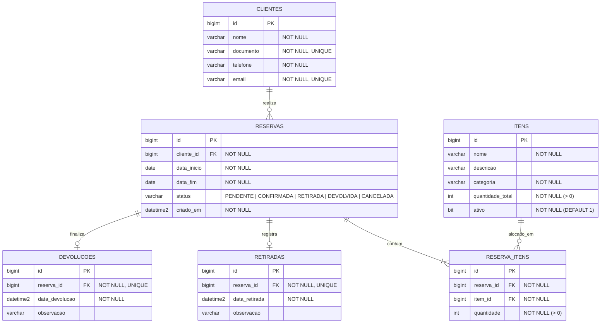

# AlugaFácil API

API REST para gerenciamento de locação de mesas, cadeiras, ferramentas e
outros equipamentos.

## Objetivo

Organizar clientes, itens, reservas, retiradas e devoluções, evitando conflitos
de datas e reservas acima da disponibilidade.

## Tecnologias

- Java 21
- Spring Boot
- Spring Web MVC
- Spring Data JPA
- Bean Validation
- Flyway
- SQL Server
- Maven

## Funcionalidades previstas

- Cadastro de clientes
- Cadastro e gerenciamento de itens
- Criação e consulta de reservas
- Validação de disponibilidade por período
- Registro de retiradas
- Registro de devoluções
- Testes automatizados

## Modelo de Dados (DER)



## Pré-requisitos

- JDK 21
- SQL Server, quando a aplicação precisar acessar o banco
- Git

Verifique a instalação:

```powershell
java -version
.\mvnw.cmd -version
```

## Configuração por variáveis de ambiente

As credenciais e a conexão com o banco não devem ser gravadas no Git.
O Spring Boot reconhece automaticamente as variáveis
`SPRING_DATASOURCE_URL`, `SPRING_DATASOURCE_USERNAME` e
`SPRING_DATASOURCE_PASSWORD`. O arquivo
[application-example.properties](src/main/resources/application-example.properties)
mostra a configuração equivalente em formato `.properties`.

### Windows PowerShell

Defina as variáveis na sessão atual do terminal:

```powershell
$env:SPRING_DATASOURCE_URL = "jdbc:sqlserver://localhost:1433;databaseName=alugafacil;encrypt=true;trustServerCertificate=true"
$env:SPRING_DATASOURCE_USERNAME = "sa"
$env:SPRING_DATASOURCE_PASSWORD = "sua-senha-local"
```

Para verificar sem exibir a senha:

```powershell
Write-Output $env:SPRING_DATASOURCE_URL
Write-Output $env:SPRING_DATASOURCE_USERNAME
if ($env:SPRING_DATASOURCE_PASSWORD) { Write-Output "SPRING_DATASOURCE_PASSWORD configurada" }
```

Para tornar as variáveis permanentes no usuário do Windows, use o Painel de
Controle ou:

```powershell
[Environment]::SetEnvironmentVariable("SPRING_DATASOURCE_URL", "jdbc:sqlserver://localhost:1433;databaseName=alugafacil;encrypt=true;trustServerCertificate=true", "User")
[Environment]::SetEnvironmentVariable("SPRING_DATASOURCE_USERNAME", "sa", "User")
[Environment]::SetEnvironmentVariable("SPRING_DATASOURCE_PASSWORD", "sua-senha-local", "User")
```


### Linux/macOS

```bash
export SPRING_DATASOURCE_URL='jdbc:sqlserver://localhost:1433;databaseName=alugafacil;encrypt=true;trustServerCertificate=true'
export SPRING_DATASOURCE_USERNAME='sa'
export SPRING_DATASOURCE_PASSWORD='sua-senha-local'
```


## Executar a aplicação

Com as variáveis configuradas:

```powershell
.\mvnw.cmd spring-boot:run
```

Linux/macOS:

```bash
./mvnw spring-boot:run
```

## Executar os testes

Windows:

```powershell
.\mvnw.cmd test
```

Linux/macOS:

```bash
./mvnw test
```

## Regra principal

Uma reserva deve ser recusada quando a quantidade solicitada ultrapassar a
disponibilidade do item no período informado.

## Organização do trabalho

O desenvolvimento é acompanhado por um quadro Kanban:

```text
Backlog -> In progress -> Done
```

As issues são classificadas como `Task`, `Feature` ou `Bug`.
